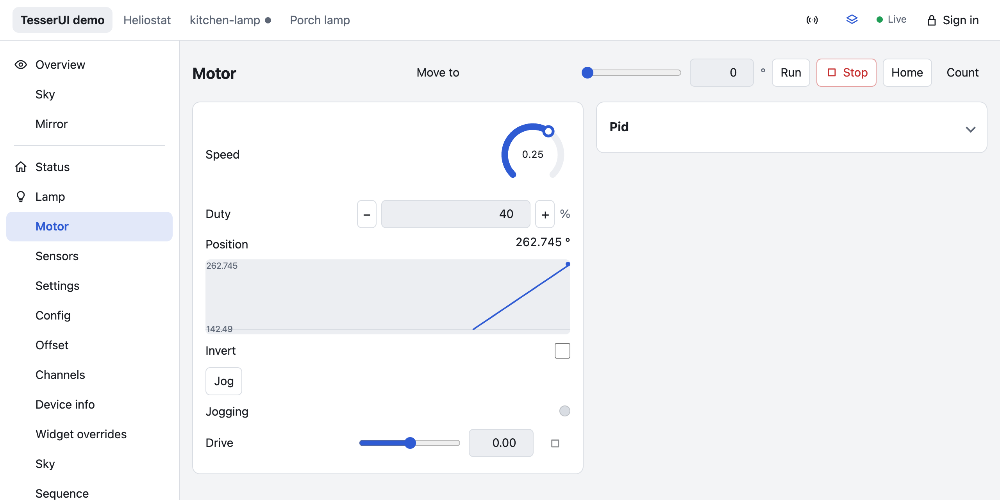
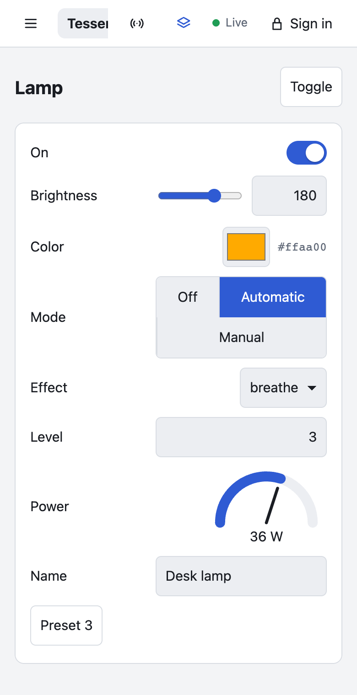
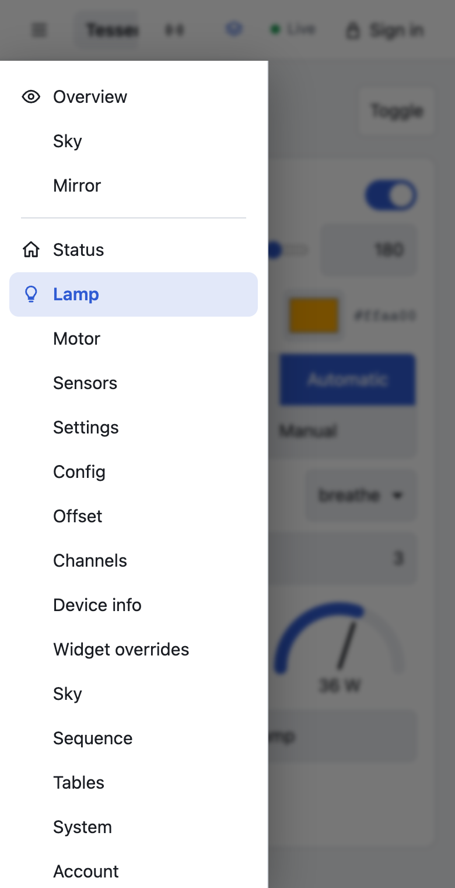
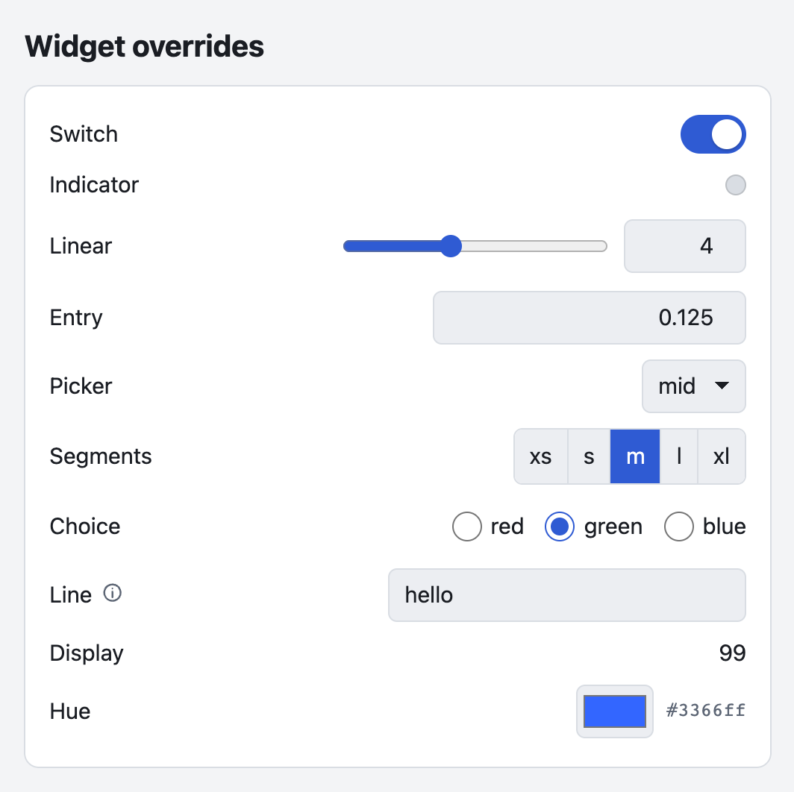
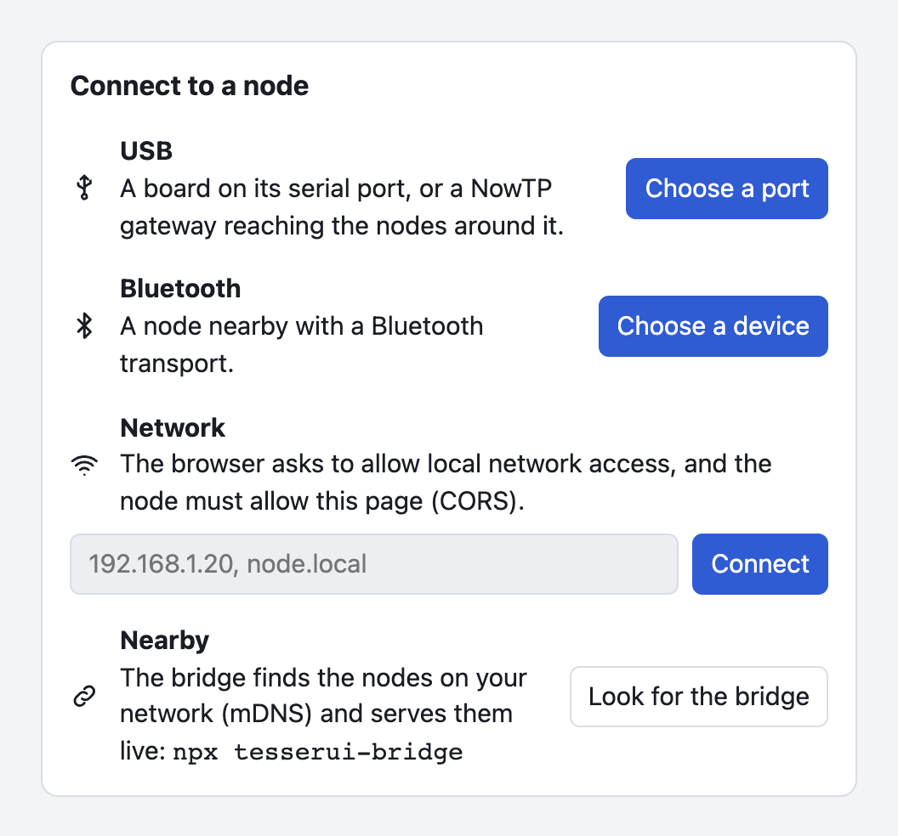
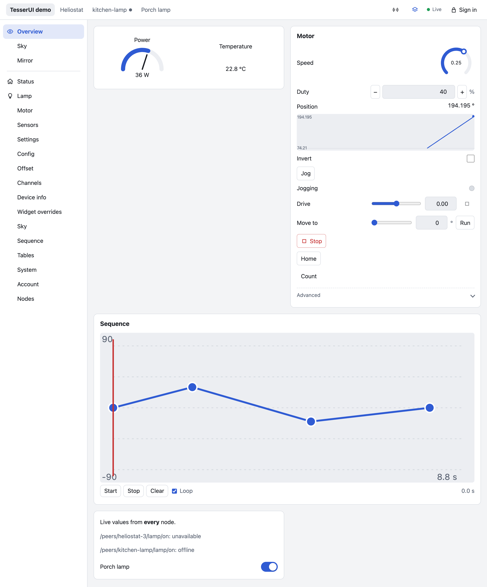
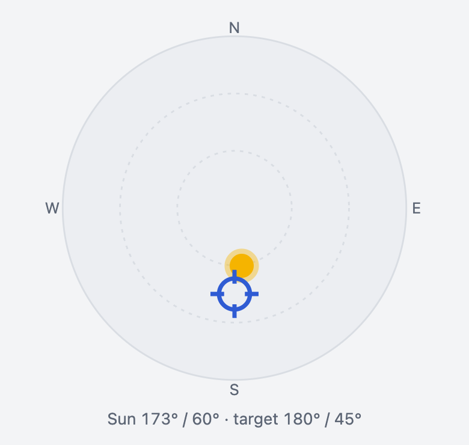

# TesserUI

User interfaces for [TesserAPI](https://github.com/leokeba/TesserAPI) nodes, rendered from their **schema**. Declare your firmware's tree once in C++, and get a live web UI without writing any UI code. A node that can't spare flash for HTML or JavaScript is still usable: another node, a CDN or the [launcher](https://leokeba.github.io/TesserUI/) provides the renderer.

<picture>
  <source media="(prefers-color-scheme: dark)" srcset="docs/images/motor-dark.png">
  
</picture>

> **Status: early development.** The web renderer is complete enough for real devices: self-hosted, UI hosts over ESP-NOW, stub pages, the launcher (USB, Bluetooth, network), views, charts, forms, files, notifications, custom elements and embedding. The LVGL touchscreen renderer has a first version with the basic widgets (switches, sliders, numbers, choices, text, buttons, readouts), tested on a 320×240 ESP32 board. The API will change before 1.0; the specification is [docs/DESIGN.md](docs/DESIGN.md).
>
> The npm packages (`tesserui`, `tesserui-bridge`) are not published yet. Until they are, run the bridge from this repository (`node bridge/bridge.mjs`) or download it for macOS (below), and point stub pages at a version of the bundle on the launcher's site (`https://leokeba.github.io/TesserUI/v<version>/ui.js`, its integrity hash in [versions.json](https://leokeba.github.io/TesserUI/versions.json); `/ui.js` is the latest, which changes with every push) or at a UI host.

## At a glance

```cpp
#include <TesserAPI.h>
#include <TesserUI.h>

tesser::Api api;
tesser::HttpServer http(api);
tesserui::WebUi web;

void setup() {
    auto& m = api.object("motor").label("Motor");
    m.value("speed", speed).range(0, 100).unit("%").step(5).ui("widget", "knob");
    m.value("invert", invert);
    m.action("stop", [] { motor.stop(); }).ui("style", "danger");
    m.object("pid").ui("advanced");

    http.enableWebSocket("/ws");
    http.begin(80, "/api");
    web.serve(http.handle());   // GET /, /ui.js and /ui/*: the whole UI, about 66 KB of flash
    api.startTask();
}
```

Open `http://<node>/`: a menu with an entry for the motor, whose page has a knob, a switch and a danger button, live through a WebSocket subscription. The page above is the same idea grown larger: the motor of the demo node in this repository.

### Try it without a board

- **The launcher:** open <https://leokeba.github.io/TesserUI/> in Chrome or Edge, install the USB gateway or the Bluetooth example on an ESP32 from there, and open it.
- **The demo node on your computer:** it runs TesserAPI on the host, and the browser talks to it as to a real node.

  ```sh
  cmake -S . -B build && cmake --build build -j     # needs TesserAPI next to this repository, or fetches it
  cd web && pnpm install && pnpm build
  node scripts/device.mjs demo                      # then open http://localhost:8090/
  ```

## Installation

TesserUI is a library for ESP32 boards under Arduino or ESP-IDF, next to [TesserAPI](https://github.com/leokeba/TesserAPI) (and [NowTP](https://github.com/leokeba/NowTP) for the ESP-NOW examples).

- **PlatformIO:** `lib_deps = https://github.com/leokeba/TesserUI.git` pulls TesserAPI and ArduinoJson; add `https://github.com/leokeba/NowTP.git` for ESP-NOW.
- **Arduino IDE:** install ArduinoJson from the Library Manager, then TesserAPI, NowTP and TesserUI with *Sketch > Include Library > Add .ZIP Library* (each repository's *Code > Download ZIP*).
- **ESP-IDF:** clone TesserAPI and TesserUI and add both to `EXTRA_COMPONENT_DIRS`, as [examples/idf/self_hosted](examples/idf/self_hosted/CMakeLists.txt) does.

The UI bundle is compiled into the firmware (`src/tesserui/bundle/tesserui_bundle.h`), so there is nothing to upload to a filesystem.

## From schema to screen

Without any hint, every node gets a widget from its schema: writable booleans are switches, numbers with a range are sliders, enums are segmented controls or selects, actions are buttons (with an input when they take an argument), events are logs, lists are editable tables, objects are cards and sections in declaration order. Each top-level object is a page of its own, reached from a menu: a sidebar, or a drawer on phones.

<p>
  
  &nbsp;
  
</p>

Hints on the same line refine it:

| Hint | Effect |
|---|---|
| `.label("Speed")`, `.unit("%")`, `.step(5)` | Label, unit, input granularity |
| `.ui("widget", "knob")` | `toggle`, `checkbox`, `led`, `slider`, `knob`, `number`, `stepper`, `select`, `segmented`, `radio`, `text`, `password`, `textarea`, `color`, `flags`, `timezone`, `readout`, `bar`, `gauge`, `chart`, `log`, `hold`, `button`, or a [custom element](#custom-widgets-and-pages) |
| `.ui("confirm", "Move the mirror?")` | Ask before a write or a call |
| `.ui("advanced")`, `.ui("hidden")`, `.ui("readonly")` | Visibility |
| `.ui("visibleWhen", "mode=manual")`, `.ui("enabledWhen", "enabled=true")` | Conditions |
| `.ui("page")`, `.ui("card")`, `.ui("tabs")`, `.ui("inline")`, `.ui("collapsed")` | Layout |
| `.ui("icon", "sun")`, `.ui("group", "Connections")` | Menu entry icon, menu heading |
| `.ui("form")` | Edits stay local until submitted as one atomic patch |



The full vocabulary is in [DESIGN.md §5](docs/DESIGN.md#5-hints-tier-1).

## Deployments

| Mode | Who stores the bundle | How |
|---|---|---|
| Self-hosted | The node (~66 KB of flash) | `web.serve(http.handle())` |
| UI host | One ESP with spare flash, also a NowTP gateway | `nowApi.mountPeers(api.object("peers"))`: every nearby node gets a page at `#/peers/<name>`, forwarded over ESP-NOW |
| Stub | The launcher's site, a CDN or the UI host | `web.integrity("sha384-…").serveStub(http.handle(), "https://leokeba.github.io/TesserUI/v0.1.20/ui.js")`: a 300-byte page, pinned to a version |
| Launcher | GitHub Pages | Pick a node: USB (Web Serial), Bluetooth (Web Bluetooth), or its address on the network; or install firmware |
| Touchscreen | n/a (LVGL 9) | `tesserui::LvglUi ui(client, display); ui.begin("/");` with a `tesser::LocalClient` for the node on the chip, then `ui.loop()` and `lv_timer_handler()` in the UI task |

A NowTP-only node with no Wi-Fi needs nothing but its tree and `nowApi.advertise()`: the UI host renders it.

### The launcher

The launcher at <https://leokeba.github.io/TesserUI/> opens any node, with no UI on the board at all:



- **USB:** plug a board in and pick its port (Web Serial). A board running the USB gateway ([Arduino](examples/arduino/UsbGateway), [ESP-IDF](examples/idf/usb_gateway)) brings the NowTP nodes around it along over the one cable.
- **Bluetooth:** pair a board running the Bluetooth example ([Arduino](examples/arduino/Bluetooth), [ESP-IDF](examples/idf/bluetooth)) from a phone or a laptop.
- **Network:** type a node's address; `?api=http://192.168.1.20/api` opens it directly.
- **Install:** put the USB gateway or the Bluetooth example on a board, from this repository's latest releases, over USB (Chrome, Edge). Another project's launcher can offer its own firmware the same way, and set up a TesserKIT device's Wi-Fi right after ([DESIGN.md §9.7.1](docs/DESIGN.md#971-installing-firmware)).

It holds several nodes at once, each a tab, with the nodes a gateway mounts as tabs of their own; one device reached several ways is one tab. It remembers them and opens them again on your next visit (a USB port this page was given opens by itself, which resets most devkits). *Apply to all*, in the header, sends each change you make on one node to every other node with the same setting ([DESIGN.md §6.6](docs/DESIGN.md#66-apply-to-all-web)).

To find the nodes on your network, run the bridge next to it: `node bridge/bridge.mjs` (`npx tesserui-bridge` once published). It finds the nodes that announce themselves over mDNS (`http.advertise("name", "name")`), which join the launcher as tabs, serves them live in any browser, brings serial ports to browsers without Web Serial, and serves the launcher itself at <http://localhost:8765/>.

On a Mac, the bridge also comes as a single executable, with nothing to install: download it for [Apple silicon](https://github.com/leokeba/TesserUI/releases/latest/download/tesserui-bridge-macos-arm64.zip) or [Intel](https://github.com/leokeba/TesserUI/releases/latest/download/tesserui-bridge-macos-x64.zip), unzip it and double-click `tesserui-bridge`, which runs in a Terminal window until you close it. It isn't notarized: macOS refuses it the first time, then *System Settings › Privacy & Security* offers *Open Anyway* (or run `xattr -d com.apple.quarantine tesserui-bridge` once). Its page at <http://localhost:8765/> is the launcher with everything built in, installing firmware from this repository's latest releases included. It has no serial ports; Chrome and Edge reach those by themselves.

Another project can release its own, with its launcher page and its firmware, by calling [`.github/workflows/bridge.yml`](.github/workflows/bridge.yml) after its release, with the files its page loads beside it (`files`, such as custom elements' scripts); its launcher then links to it with `window.TESSER.bridge = {repo, name}`. Locally: `pnpm macos` in `bridge/` ([Bun](https://bun.sh), and `pnpm build` in `web/` first), with `--page`, `--file`, `--name`, `--launcher` and `--repo`.

## Views

Pages that combine values from several nodes are declared on the node that serves the UI:

```cpp
tesserui::Views views(api);
auto& field = views.page("field", "Field");
field.row().widget("gauge", "/sensors/wind").widget("readout", "/sensors/sun/elevation");
field.each("/peers", "$/heliostat/status");       // one entry per mounted peer
field.card("Calibration").node("/calib");
```



## Custom widgets and pages

What the generic widgets can't show is a [custom element](docs/DESIGN.md#98-custom-elements): a standard web component, written with any framework or none. A hint puts it on any node, an object included, and a view of one element is a whole custom page:

```cpp
auto& sky = api.object("sky").ui("widget", "x-sun-dial").ui("script", "/ext/sun-dial.js");
views.page("sky", "Sky").widget("x-sun-dial", "/sky");
web.asset("/ext/sun-dial.js", kSunDial, sizeof(kSunDial) - 1, "text/javascript");   // served from flash
```



TesserUI sets the element's `value` (the node's values), `schema` and `disabled`, and gives it a `tesser` handle to write values and call actions. If it can't load, the inferred widget stands in. [examples/elements/sun-dial.js](examples/elements/sun-dial.js) is a complete one.

## Embedding and theming

The npm package mounts UIs in an application's own pages, with their own sessions and scoped styles:

```js
import { mount } from "tesserui";
mount(document.getElementById("motor"), { api: "http://heliostat.local/api", path: "/motor", routing: "memory", header: false });
```

The interface's colors (`theme`) and its own text (`strings`) are options too: `web.theme("accent", "#d97706").text("Advanced", "Avancé")` on a node. It follows the system's light or dark mode.

## Examples

| Example | Arduino | ESP-IDF |
|---|---|---|
| HTTP, WebSocket and the UI on one node | [SelfHosted](examples/arduino/SelfHosted) | [self_hosted](examples/idf/self_hosted) |
| A UI host and the NowTP-only nodes it renders (the host needs the *Minimal SPIFFS* partition scheme, and so does the node on an ESP32-C3) | [UiHost](examples/arduino/UiHost), [NowTpNode](examples/arduino/NowTpNode) | |
| The UI loaded from a CDN by a 300-byte page | [Stub](examples/arduino/Stub) | |
| A custom element served from flash, on a node and as a custom page | [CustomWidget](examples/arduino/CustomWidget) | |
| A NowTP gateway on USB, for the launcher (on an ESP32-C3, the *Minimal SPIFFS* partition scheme) | [UsbGateway](examples/arduino/UsbGateway) | [usb_gateway](examples/idf/usb_gateway) |
| A node over Bluetooth LE, for the launcher | [Bluetooth](examples/arduino/Bluetooth) | [bluetooth](examples/idf/bluetooth) |
| A node over classic Bluetooth serial (ESP32 only) | [BluetoothSerial](examples/arduino/BluetoothSerial) | |
| A touchscreen UI for the node on the chip (the "cheap yellow display" with two USB ports) | | [lcd_local](examples/idf/lcd_local) |
| A remote for the NowTP nodes around it: lists them, opens any of them (the same board by touch, or a LilyGO T-Display by its two buttons: `-DBOARD=tdisplay`) | | [lcd_remote](examples/idf/lcd_remote) |

## Development

```sh
cd web && pnpm install && pnpm test && pnpm build    # web renderer; regenerates src/tesserui/bundle/tesserui_bundle.h
pnpm dev                                              # then http://localhost:5173/?api=http://<node-ip>/api
cmake -S . -B build && cmake --build build -j && ctest --test-dir build   # C++ (TesserAPI from ../TesserAPI or GitHub)
node web/scripts/device.mjs demo                      # the demo node on the host: http://localhost:8090/
./build/tesserui_lcd demo                             # the LVGL renderer on the demo node, in a window (SDL2)
cd web && pnpm e2e                                    # Playwright, against the demo node (after both builds)
```

No board is needed: the demo node runs TesserAPI on the host, and the browser talks to it as to a real one. The screenshots in [docs/images](docs/images) are of it. The web renderer is TypeScript and Svelte 5; both it and the LVGL renderer (C++) test against the schemas and expected UI models in [fixtures/](fixtures). Behaviour changes go into [docs/DESIGN.md](docs/DESIGN.md) with the code.

## Requirements

- TesserAPI (same requirements: ESP-IDF ≥ 5.1 or Arduino-ESP32 ≥ 3.0, C++17, ArduinoJson 7)
- Evergreen browsers; Web Serial and Web Bluetooth need a Chromium-based browser

## License

MIT
